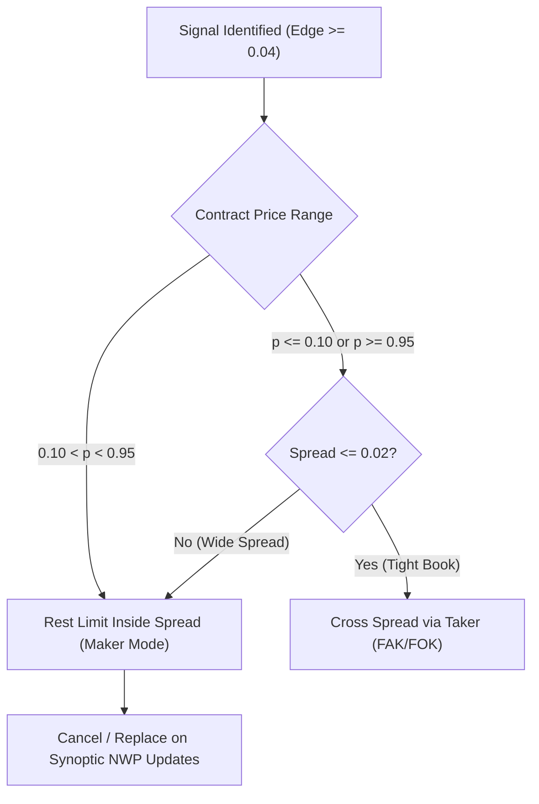

# Institutional Capital & Risk Allocation Strategy
## Multi-City Polymarket Weather Prediction Portfolio

---

## 1. Executive Summary & Core Edge

The weather prediction strategy operates on Polymarket's daily **Highest Temperature** bucket markets across five tradeable global hubs (**London, NYC, Miami, Beijing, Seoul**).

### The Structural Edge
Traditional prediction market participants evaluate weather contracts using simple weather app forecasts or heuristic rules, leading to two systematic behavioral pricing anomalies:
1. **Favorite-Longshot Bias on Tails**: Retail participants overprice "consensus certainty" and underprice low-probability extremes. When an ensemble indicates a shifting regime, buckets priced at $0.02–$0.08 often carry true probabilities of 10–18%.
2. **Exponential Tail Decaying Trap**: Naive market makers assume normal (Gaussian) distributions. However, true atmospheric error distributions are **leptokurtic (fat-tailed)**. Selling unconstrained NO at $0.98–$0.99 yields negative expected value because real tail events hit twice as often as Gaussian models predict.

**The Solution**: An asymmetric portfolio strategy combining:
* **Convex Cheap YES Accumulation** ($p \le \$0.15$): High positive skewness, asymmetric upside (up to 20:1 payouts), and strictly bounded downside.
* **Student-t Filtered NO Harvesting** ($p \ge \$0.93$): High-probability yield with mathematical tail-safety filtering.

---

## 2. Mathematical Capital Allocation Model

### 2.1 The Correlated Multi-Bucket Problem
A standard Kelly criterion formula:
$$f^* = \frac{p \cdot b - q}{b} = \frac{p - \text{price}}{1 - \text{price}}$$
assumes each trade is an independent Bernoulli trial.

On Polymarket, a single city-day comprises $K \approx 8–10$ mutually exclusive buckets $\{B_1, B_2, \dots, B_K\}$ partitioning the temperature space ($\sum_{k=1}^K \mathbf{1}_{B_k} = 1$). 
* Buying NO on multiple buckets of the *same* day creates **positive correlation**: if the forecast verified near the center, all NO bets win; if an extreme temperature hits, multiple buckets lose simultaneously.
* Buying YES on multiple buckets creates **mutually exclusive outcomes**: at most one YES can win.

Applying unconstrained Kelly across 8 buckets on a single city-day would allocate up to $25–40\%$ of bankroll to a single weather realization.

### 2.2 Constrained Categorical Kelly Formula
To maximize long-term geometric compounding while preventing catastrophic correlation drawdowns, optimal capital weight $w_k$ for bucket $k$ on market event $M$ is solved via constrained log-wealth optimization:

$$\max_{\{w_k\}} \mathbb{E}\left[ \log\left( 1 + \sum_{k \in M} w_k R_k \right) \right]$$

Subject to institutional constraints:
1. **Fractional Kelly Damping**:
   $$w_k = \lambda_{\text{Kelly}} \cdot \frac{p_k - \text{price}_k - \text{fee}_k}{\text{price}_k (1 - \text{price}_k)}, \quad \lambda_{\text{Kelly}} = 0.25 \text{ (Quarter-Kelly)}$$
2. **Single-Trade Bound**:
   $$w_k \le \text{CAP}_{\text{trade}} = 2.0\% \text{ of Bankroll}$$
3. **Correlated City-Day Bound**:
   $$\sum_{k \in \text{city-day}} w_k \le \text{CAP}_{\text{market}} = 5.0\% \text{ of Bankroll}$$
4. **Global Daily Exposure Bound**:
   $$\sum_{\text{all active}} w_k \le \text{CAP}_{\text{portfolio}} = 15.0\% \text{ of Bankroll}$$
5. **Cash Collateral Reserve**:
   $$\text{Cash Reserve} \ge 50.0\% \text{ of Total Equity (Unencumbered USDC)}$$

---

## 3. Asymmetric Leg Architecture

| Strategy Dimension | Leg A: Cheap YES Convexity | Leg B: Calibrated Tail NO Yield |
|---|---|---|
| **Price Domain** | $\$0.01 \le p \le \$0.15$ | $\$0.92 \le p \le \$0.985$ |
| **Edge Requirement** | $\text{Model } P(YES) - \text{Ask} - \text{Fee} \ge 0.04$ | $\text{Model } P(NO) - \text{Ask} - \text{Fee} \ge 0.03$ |
| **Tail Safety Condition** | $P(YES)_{\text{Student-t}} \ge 1.5 \times \text{Ask}$ | $P(YES)_{\text{Student-t}} \times 1.5 < (1 - \text{Ask})$ |
| **Payoff Profile** | Highly convex (5x to 50x ROI) | High win rate ($>96\%$), steady yield |
| **Max Loss per Share** | Purchase price ($\le \$0.15$) | Purchase price ($\approx \$0.95$) |
| **Empirical Backtest EV** | **+$0.108$ / trade** (20.4% Win Rate) | **+$0.068$ / trade** (96.9% Win Rate) |

### Tail Safety Rule for Leg B (NO Selling)
Never sell NO contracts on extreme buckets solely because Gaussian probability indicates $0.0\%$. NO orders are strictly prohibited unless:
$$\frac{1 - \text{price}}{\text{Student-t } P(YES)} \ge 1.50$$
This guarantees a minimum $50\%$ safety margin against leptokurtic weather shocks.

---

## 4. Execution Economics & Venue Fee Model

### 4.1 Polymarket Dynamic Taker Fee Mechanics
Polymarket applies a parabolic dynamic fee schedule on non-geopolitical categories:
$$\text{Fee}_{\text{taker}} = \text{rate} \cdot p \cdot (1 - p), \quad \text{rate} = 0.05 \text{ (Weather)}$$

* **At Mid-Prices ($p = 0.50$)**: Taker fee is at maximum ($1.25\text{¢}$/share = $2.5\%$ of capital).
* **At Tails ($p = 0.05$ or $p = 0.95$)**: Taker fee decays to $0.24\text{¢}$/share ($0.25\%$ of capital).
* **Makers Pay ZERO Fee**: Passive limit orders earn 0 fee plus daily pro-rata rebates from the 20% protocol rebate pool.

### 4.2 Order Routing Decision Matrix

1. **Passive Limit Orders (Maker)**:
   * Mandatory for all trades in the $0.15 \le p \le 0.85$ region.
   * Rest orders at `Best_Bid + 0.01` or `Fair_Value - 0.02`.
   * Order refresh: Re-calculate and cancel/replace upon publication of major synoptic model runs (GFS 00/06/12/18z; ECMWF 00/12z).
2. **Aggressive Market Orders (Taker)**:
   * Permitted exclusively for extreme tails ($p \le 0.10$ or $p \ge 0.95$) where taker fees are $< 0.25\text{¢}$/share and edge exceeds $4.0\text{¢}$.

---

## 5. Drawdown Controls & Circuit Breakers

### 5.1 Hard Portfolio Circuit Breakers
1. **Daily Loss Stop (5.0%)**:
   * Evaluated continuously in `risk.py`.
   * If $\text{Realized P&L} + \text{Unrealized P&L} \le -0.05 \times \text{Starting Equity}$, the engine writes `HALT` and cancels all open resting orders.
2. **Rolling 100-Trade Brier Gate**:
   * Rolling verification in `paper.py`:
     $$\text{Brier}_{\text{model}} = \frac{1}{100} \sum_{i=1}^{100} (p_{\text{model}, i} - o_i)^2, \quad \text{Brier}_{\text{market}} = \frac{1}{100} \sum_{i=1}^{100} (\text{price}_i - o_i)^2$$
   * If $\text{Brier}_{\text{model}} \ge \text{Brier}_{\text{market}}$, trading immediately halts.
3. **Station Disconnect Circuit Breaker**:
   * If station ground truth has not published or reports anomalous data, positions remain open and are never marked to interpolated grid approximations.

---

## 6. City Allocation Matrix & Launch Priority

Based on the 90-day walk-forward empirical audit:

| Priority | City Hub | Station | Lead 1 Stdev | Brier Skill | Optimal Role in Portfolio |
|---|---|---|---|---|---|
| **Tier 1** | **London** | EGLC (London City) | $1.11^\circ\text{C}$ | **+21.0%** | Primary market-making hub; tightest spreads |
| **Tier 1** | **Seoul** | Inland (Gimpo Cell) | $1.31^\circ\text{C}$ | **+19.4%** | High-edge tail harvester; inland bias fixed |
| **Tier 2** | **NYC** | KLGA (LaGuardia) | $2.55^\circ\text{F}$ | **+14.4%** | Highest liquidity on Polymarket; core volume |
| **Tier 2** | **Beijing** | ZBAA (Capital Airport) | $1.34^\circ\text{C}$ | **+10.9%** | Secondary hub; wide retail pricing gaps |
| **Tier 3** | **Miami** | KMIA (Miami Intl) | $2.37^\circ\text{F}$ | **+5.6%** | Low volatility; conservative sizing |
| **Gated** | **Hong Kong** | HKO (Observatory) | $1.22^\circ\text{C}$ | **N/A** | Blocked from real-time loop pending daily feed |
